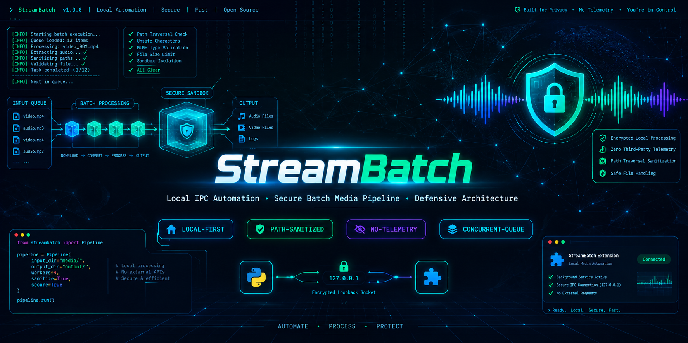
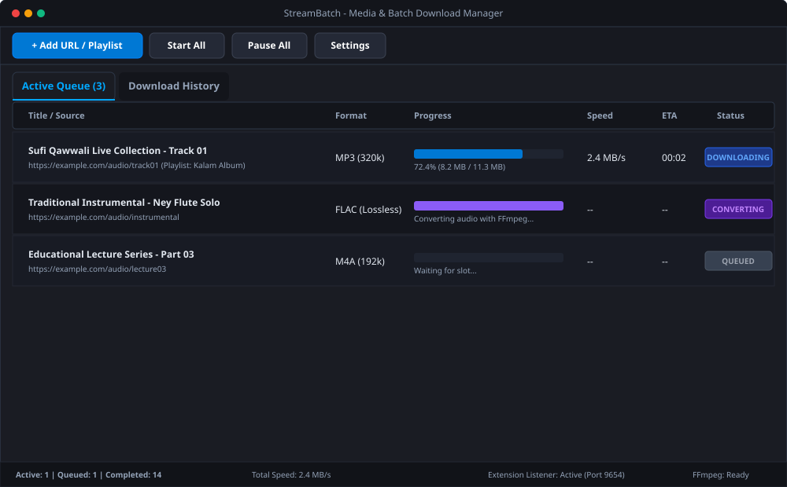

# StreamBatch

<p align="center">
  
</p>


<p align="center">
  <strong>Desktop Media Retrieval, Playlist Automation &amp; Batch Audio Transcoding Engine</strong>
</p>

<p align="center">
  <a href="#motivation"></a>
  <a href="#architecture"></a>
  <a href="docs/TESTING.md"></a>
  <a href="docs/SECURITY.md"></a>
  <a href="#license"></a>
</p>

---

## Motivation

The idea started with a small problem at home. My grandfather uses a keypad phone and asked me to prepare audio files of Sufi kalams and qawwali for him. Handling each item individually was repetitive, especially when I needed to process a whole playlist. I decided to automate the workflow. I built a tool that can take a supported playlist link, organize its items into a queue, process audio in the background, and save the output in a format suitable for offline listening. What began as a practical family task became a hands-on learning project in automation, background processing, browser integration, and error handling.

While my primary career focus is **cybersecurity and penetration testing**, this project serves as a supporting software engineering artifact demonstrating asynchronous systems, Qt GUI architecture, inter-process communication (IPC), and defensive input validation.

---

## Key Features (Confirmed & Tested)

- **Responsive Dark GUI**: Developed with PySide6 (Qt6 Widgets). Uses a decoupled background execution model to ensure the UI stays responsive at 60 FPS during heavy downloads.
- **Playlist Inspection & Batch Picker**: Queries playlist metadata in 1–2 seconds via shallow inspection (`extract_flat`), presenting a checklist table to selectively queue individual tracks.
- **Audio Transcoding Pipeline**: Converts retrieved streams into **MP3, M4A, FLAC (Lossless), WAV (Lossless), AAC**, and **Opus** using FFmpeg.
- **Audio Bitrate Profiles**: Supports `320 kbps`, `256 kbps`, `192 kbps`, `128 kbps`, and `Source/VBR 0`.
- **Video Stream Merging**: Downloads and muxes video and audio streams into single `.mp4` containers (Best, 1080p, 720p).
- **Non-Blocking Queue Management**: `QThreadPool` worker slots (1 to 10 concurrent threads) with pause, resume (retaining `.part` chunks), cancel, and retry capabilities.
- **SQLite WAL Persistence**: State persistence across sessions with automated duplicate URL detection and searchable history.
- **Intelligent FFmpeg Discovery**: Multi-path auto-locator detecting FFmpeg across WinGet, system PATH, Scoop, and Chocolatey.
- **Browser Extension (Manifest V3)**: Chrome/Edge extension dispatching media links to the desktop application over local loopback HTTP (`127.0.0.1:9654`).

<p align="center">
  
</p>

---

## Technical Architecture

StreamBatch decouples user interaction from long-running network and CPU operations across three core layers:

```
[ Browser Extension (MV3) ]        [ Direct Clipboard / User Input ]
             \                                    /
              v                                  v
   +--------------------------------------------------------------+
   |              Presentation Layer (PySide6 / Qt)               |
   |   - MainWindow, AddDialog (Checklist), Settings, History     |
   +------------------------------+-------------------------------+
                                  | Qt Signals / Slots (Throttled 10 Hz)
                                  v
   +--------------------------------------------------------------+
   |          Concurrency & Orchestration (QueueManager)          |
   |   - QThreadPool (1-10 workers), State Machine, Recovery      |
   +---------------+------------------------------+---------------+
                   |                              |
                   v                              v
   +-------------------------------+ +----------------------------+
   | Media Engine (yt-dlp + FFmpeg)| | Persistence (SQLite in WAL)|
   | - Stream pull & transcoding   | | - Queue state & history    |
   +-------------------------------+ +----------------------------+
```

For the complete technical breakdown, see **[docs/ARCHITECTURE.md](docs/ARCHITECTURE.md)** and **[docs/WORKFLOW.md](docs/WORKFLOW.md)**.

---

## Audio Transcoding Note

> [!NOTE]
> Converting online lossy audio streams into MP3 or FLAC provides compatibility for offline playback on specific target hardware (such as older keypad phones or car stereos). However, transcoding compressed web audio into an uncompressed format (e.g. FLAC or 320 kbps MP3) does not reconstruct acoustic data discarded during original lossy encoding. StreamBatch targets format compatibility and convenience, not artificial audio upscaling.

---

## Responsible Use & Platform Guidelines

StreamBatch is an educational automation tool designed for personal backup and offline listening on owned or authorized hardware.

- **Authorized Media Only**: This tool should be used only with content the user owns, content in the public domain, creative commons material, or content where the hosting service explicitly permits offline personal retrieval.
- **No Access Control Bypassing**: StreamBatch does not bypass digital rights management (DRM), paywalls, private tokens, or website access restrictions. It relies on standard, publicly accessible streaming protocols handled by `yt-dlp`.
- **Platform Terms of Service**: Users are responsible for complying with the Terms of Service of any third-party website or media provider from which content is retrieved.

---

## Quick Start (Windows)

### Prerequisites
1. **Python 3.10+**: [python.org](https://www.python.org/) (ensure "Add Python to PATH" is checked).
2. **FFmpeg**: Install via Windows Package Manager:
   ```powershell
   winget install Gyan.FFmpeg.Essentials --source winget
   ```

### Setup & Launch
```powershell
# 1. Clone the repository
git clone https://github.com/your-username/StreamBatch.git
cd StreamBatch

# 2. Install dependencies
python -m pip install -r requirements.txt

# 3. Launch application
python app.py
```

For silent launch without a terminal window, run `pythonw app.py`. Full instructions are documented in **[docs/INSTALLATION.md](docs/INSTALLATION.md)**.

---

## Verification & Automated Testing

StreamBatch includes an automated test suite verifying database CRUD operations, FFmpeg detection, local IPC communication, queue state transitions, and URL scheme safety:

```powershell
python test_streambatch.py
```

All 8 tests execute in an ephemeral SQLite database environment without touching user data or downloading external content. See **[docs/TESTING.md](docs/TESTING.md)** for details.

---

## Documentation Index

- **[docs/ARCHITECTURE.md](docs/ARCHITECTURE.md)**: Detailed component breakdown, threading boundaries, and signal throttling.
- **[docs/WORKFLOW.md](docs/WORKFLOW.md)**: Step-by-step lifecycle from URL ingestion to transcoded audio output.
- **[docs/INSTALLATION.md](docs/INSTALLATION.md)**: Windows installation guide and desktop shortcut setup.
- **[docs/USER_GUIDE.md](docs/USER_GUIDE.md)**: Guide on batch track selection, formats, and queue management.
- **[docs/SECURITY.md](docs/SECURITY.md)**: Threat modeling, input sanitization, and vulnerability reporting.
- **[docs/PRIVACY.md](docs/PRIVACY.md)**: Verification of zero telemetry, local processing, and data retention policies.
- **[docs/TESTING.md](docs/TESTING.md)**: Test catalog, headless verification commands, and known gaps.
- **[docs/ROADMAP.md](docs/ROADMAP.md)**: Implemented features vs planned enhancements (speed limiter, subtitles, cover art).
- **[docs/RELEASE_AUDIT.md](docs/RELEASE_AUDIT.md)**: Pre-release audit of dependencies, licensing, and security boundaries.
- **[docs/GRAPHICS_GENERATION_PROMPTS.md](docs/GRAPHICS_GENERATION_PROMPTS.md)**: Prompts for reproducing or modifying project graphics.

---

## License

No license has been assigned to this repository yet.

- **PySide6** is licensed under LGPLv3.
- **yt-dlp** is licensed under The Unlicense (Public Domain).
- **FFmpeg** is licensed under LGPLv2.1+ / GPLv2+.

A permissive open-source license (such as **MIT** or **Apache 2.0**) or a copyleft license (such as **GPLv3**) may be selected depending on your intended distribution model. Please select your preferred license before publishing the repository.
